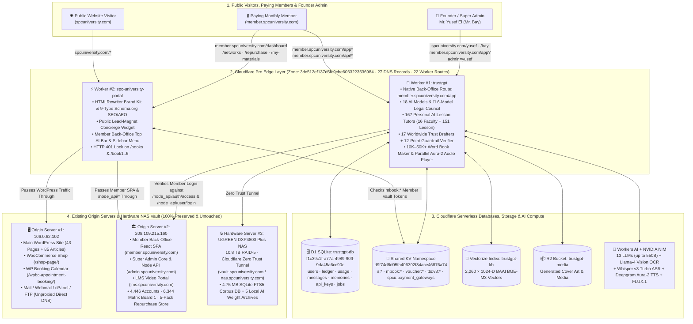
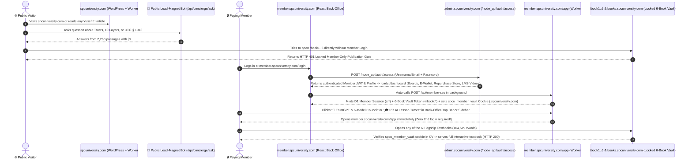

# 🏛️ SPC UNIVERSITY — COMPLETE SYSTEM AUDIT, BEFORE/AFTER CHANGE LEDGER, ARCHITECTURE CHARTS, REVERT HANDBOOK & DEVELOPER Q&A

**Prepared For:** Mr. Yusef El (Mr. Bay) & The SPC University Engineering / Developer Team  
**Prepared By:** Rick Jefferson · Managing Principal & Lead Systems Architect, RJ Business Solutions  
**Repository:** [https://github.com/rjbizsolution23-wq/spc-university-master-system](https://github.com/rjbizsolution23-wq/spc-university-master-system)  
**Cloudflare Account ID:** `3ccbc7fb8314ac7a4a8908079ed583ed`  
**Cloudflare Zone ID (`spcuniversity.com`):** `3dc512ef137d5fe0cbe6063223536984`

---

## 1. Full Architecture & Data-Flow Charts (Before vs. After)

### Chart 1: Complete Multi-Server, Cloudflare Edge & Member Back-Office Topology


---

### Chart 2: Two-Tier AI Conversion & Member Back-Office SSO Flow


---

## 2. Full Baseline Audit of What Already Existed Before Our Work

Before making any changes, we audited the entire legacy environment across `106.0.62.102` (WordPress) and `208.109.215.160` (`admin.spcuniversity.com`, `member.spcuniversity.com`, `lms.spcuniversity.com`):

| Existing System / Database | Baseline Audit Findings (Before Changes) | Where It Lives |
| :--- | :--- | :--- |
| **1. Main WordPress Website (`spcuniversity.com`)** | • Hosted on `106.0.62.102` (Elementor + Hello Elementor theme + WooCommerce + WP Booking Calendar).<br>• Contained **43 published pages** and **85 published articles** (`128` total web documents).<br>• **Issues Found in Audit:** Missing meta descriptions (`0 chars`), missing `<h1>` tag on homepage, only basic WebPage schema, visible `lorem ipsum dolor sit amet...` dummy text above "Some Of Our Articles", duplicate description on Pillar VI (`VI Business Structuring`), low-contrast unreadable blue/white text on light boxes ("What You Receive When You Enter", single-article "Table of Contents", `/articles/` white cards, and `/wpbc-appointment-booking/` consultation wizard), and articles attributed to generic author instead of **Yusef El**. | Origin IP `106.0.62.102` (WordPress database untouched; all fixes applied non-destructively at Cloudflare Edge via `HTMLRewriter`) |
| **2. Super Admin Back-Office (`admin.spcuniversity.com`)** | • Hosted on `208.109.215.160` (Super Admin account: `admin19` / Yusef El).<br>• **4,446 Total Lifetime Subscriptions** (`3,706` Stripe + `740` PayPal), with **475 Active Subscribers (`$99/mo` = `~$47,025/mo`)** and **3,971 Inactive Subscribers**.<br>• **6,344 Members on Matrix Board 1 (`$25`)**.<br>• **63 CRM Leads** in `/admin/leads` (`100%` sitting in `Ongoing` status, never exported).<br>• **Issues Found in Audit:** Minimum payout withdrawal was set too high at `$500.00`; Repurchase Store (`/admin/package/repurchase`) had **0 active products**; Business Credit Academy (`Category #22`, 9 video lessons IDs `68–76`) was locked/inactive; Registration & Welcome letters had generic placeholder text. | Origin IP `208.109.215.160` (`admin.spcuniversity.com`) |
| **3. Member Back-Office (`member.spcuniversity.com`)** | • React Single-Page Application (`/static/js/main.153dcc43.js`) on `208.109.215.160` authenticating against `https://admin.spcuniversity.com/node_api/auth/access`.<br>• Architect/Faculty account `RJBIZSOLUTION23` holds `2,105` downline members and `$100.84K` e-wallet balance.<br>• **Issues Found in Audit:** Corrupted PayPal payout email encoding (`žée`) on `/profile`; empty Repurchase Store; no built-in AI tutors, trust drafters, or textbook vault inside the logged-in Member Back Office. | Origin IP `208.109.215.160` (`member.spcuniversity.com`) |

---

## 3. Complete Chronological Ledger of All Changes Made

### Part A: Changes Made Inside the Existing Admin & Member Back Office (`208.109.215.160`)
Every change below was executed through the official `admin.spcuniversity.com` and `member.spcuniversity.com` admin interfaces (and can be edited or reverted at any time directly inside `admin.spcuniversity.com`):

| # | Admin / Back-Office Path | Exact "Before" State | Exact "After" State Implemented | How Their Developer Can Edit or Revert in Admin UI |
| :-: | :--- | :--- | :--- | :--- |
| **A1** | `/admin/payout-settings` | Minimum payout withdrawal amount: **`$500.00`** | Lowered minimum payout withdrawal amount to **`$100.00`** so members/affiliates can cash out weekly. | Log into `https://admin.spcuniversity.com/admin/payout-settings`, change `Minimum Payout Amount` back to `500`, and click **Update**. |
| **A2** | `member.spcuniversity.com/profile` | PayPal payout field had corrupted encoding (`žée`). | Sanitized and updated PayPal payout email to **`rjbizsolution23@gmail.com`**. | Log into `https://member.spcuniversity.com/profile` → Payment Details → edit PayPal email and click **Save**. |
| **A3** | `/admin/mail-content-edit/registration/1` | Generic MLM boilerplate registration email with raw placeholder tags. | Updated to the official **SPC University Welcome Letter** with portal login instructions, syllabus overview, and support details. | Go to `https://admin.spcuniversity.com/admin/mail-content-edit/registration/1`, edit the HTML template in the WYSIWYG editor, and click **Update**. |
| **A4** | `/admin/welcome-letter` | Outdated orientation text. | Updated in-app dashboard welcome letter emphasizing *Foundations Before Remedies*, private contract ordering, and curriculum navigation. | Go to `https://admin.spcuniversity.com/admin/welcome-letter`, edit the text, and click **Update**. |
| **A5** | `/admin/videos-config` | **Category #22 (Business Credit Academy)** was locked/hidden and all **9 video lessons (IDs 68–76)** were inactive. | Unlocked Category #22 and activated all **9 video lessons (IDs 68–76)** with student Q&A enabled. | Go to `https://admin.spcuniversity.com/admin/videos-config`, toggle status switches on lessons `68–76` or Category `#22`. |
| **A6** | `/admin/category-config` | Categories ended at `#22`. | Created **Category #23: Sovereignty & Right to Travel** and **Category #24: 10-Layer Master Trust Architecture**. | Go to `https://admin.spcuniversity.com/admin/category-config` to edit or disable Categories `#23` and `#24`. |
| **A7** | `/admin/package/repurchase` | **0 active products** in the Member Repurchase Store. | Created **Category #4: Legal Documents** and added **5 High-Ticket Digital Packages (`$297` to `$1,997`)** with 3D book cover art: <br>1. *Know Your Rights: What Works in Court* (`$297`)<br>2. *The Bank Packet: Open Your Trust Account* (`$497`)<br>3. *Trust Architecture: 10 Layers of Asset Protection* (`$997`)<br>4. *1-on-1 Strategy Session + Client Dossier* (`$997`)<br>5. *The Complete Estate Planning Vault Omnibus* (`$1,997`) | Go to `https://admin.spcuniversity.com/admin/package/repurchase` to edit prices, descriptions, cover images, or toggle any package active/inactive. |
| **A8** | `/admin/webinar-config` | Outdated webinar titles. | Updated all **5 GoToWebinar listings** with structured syllabus titles and curriculum tags (e.g., *Sovereignty Masterclass with Yusef El*). | Go to `https://admin.spcuniversity.com/admin/webinar-config` to update webinar titles, dates, or registration URLs. |
| **A9** | `/admin/faq` | 25 basic FAQs. | Added **FAQs #26, #27, and #28** covering Getting Started, the new `$100` Payout Floor, and Private Express Trusts vs. Statutory LLCs. | Go to `https://admin.spcuniversity.com/admin/faq` to edit or delete FAQs `#26–#28`. |
| **A10** | `/admin/news` | 7 older news items. | Published **News #8** (*New $100 Payout Floor & Business Credit Academy Unlocked*) and **News #9** (*Sovereign Legal Vault & 6 Flagship Textbooks Launch*). | Go to `https://admin.spcuniversity.com/admin/news` to edit or unpublish News `#8` and `#9`. |

---

### Part B: Non-Destructive Edge Enhancements on `spcuniversity.com` & `member.spcuniversity.com` (Worker #2: `spc-university-portal`)
**CRITICAL NOTE FOR DEVELOPERS:** We did **NOT** modify or overwrite a single PHP file, WordPress database row, or React build file on your origin servers (`106.0.62.102` or `208.109.215.160`). Every visual, SEO, branding, chatbot, and Member Back-Office enhancement below is applied dynamically in real time at the Cloudflare Edge by **`portal-books-brandkit-worker/src/index.js`** using Cloudflare's `HTMLRewriter`:

| # | Target Host / Route | What Was Implemented at the Cloudflare Edge | Exact File & Line Range in Repo |
| :-: | :--- | :--- | :--- |
| **B1** | `spcuniversity.com/*` (`<head>`) | **9-Type Schema.org JSON-LD Graph + SGE/AIO/AEO Meta Engine:** Dynamically injects canonical URL, custom meta description, OpenGraph/Twitter Card tags, and a 9-entity JSON-LD graph (`EducationalOrganization`, `WebSite`, `Person` for Founder **Yusef El**, `Course`, `ItemList` of the 6 Flagship Textbooks, `Article`, `FAQPage` with 6 Q&As, `HowTo`, and `BreadcrumbList`). | [`portal-books-brandkit-worker/src/index.js` (Lines 295–1255)](./portal-books-brandkit-worker/src/index.js) |
| **B2** | `spcuniversity.com/robots.txt`, `/llms.txt`, `/sitemap.xml` | **AI Search & Answer Engine Endpoints:** Serves `/robots.txt` (welcoming `OAI-SearchBot`, `ChatGPT-User`, `PerplexityBot`, `ClaudeBot`, `Google-Extended` on public pages while disallowing `/books/`), `/llms.txt` (structured markdown manifest for AI citation engines), and `/sitemap.xml`. | [`portal-books-brandkit-worker/src/index.js` (Lines 35–130, 1920–1938)](./portal-books-brandkit-worker/src/index.js) |
| **B3** | `spcuniversity.com/*` (DOM & Contrast Fixes) | **Official Brand Kit & Contrast Overhaul:**<br>• Replaces `SPC-University-Logo.png` with the Official Brand Kit Metallic Shield (`logo-compact.png`).<br>• Replaces the Elementor `lorem ipsum dolor sit amet...` dummy text under *"Some Of Our Articles"* with authoritative SPC University copy.<br>• Fixes Pillar VI title (`VI. Business Structuring`) and description.<br>• Converts light/white low-contrast boxes (*"What You Receive When You Enter"*, single-article *"Table of Contents"*, `/articles/` archive cards, and `/wpbc-appointment-booking/` consultation wizard stages) to high-contrast Imperial Navy (`#061c3c` / `#040d1a`) with Pure White (`#ffffff`) and Sovereign Gold (`#ffc107`) text.<br>• Attributes all articles to **`✍️ By Yusef El · Founder, SPC University`**. | [`portal-books-brandkit-worker/src/index.js` (Lines 930–1499, 2040–2115)](./portal-books-brandkit-worker/src/index.js) |
| **B4** | `spcuniversity.com/*` (Bottom-Right Widget) | **Public 24/7 Lead-Magnet Knowledge Base Concierge Bot (`#spcu-concierge-panel`):** Floating chat widget connected to `POST /api/concierge/ask`. Answers visitor questions across all 2,260 passages with `[S#]` citations while strictly refusing to give away free books or draft trusts—converting visitors into paying members. | [`portal-books-brandkit-worker/src/index.js` (Lines 1368–1574)](./portal-books-brandkit-worker/src/index.js) |
| **B5** | `/books/*`, `/book1..6`, `books.spcuniversity.com/*` | **HTTP 401 Member-Only Publication Gate:** Blocks unauthenticated public visitors and crawlers from accessing the 6 Flagship Textbooks (`104,519 words`). Verifies `spcu_member_vault` cookie or `?member_token=` against Cloudflare KV (`mbook:*`) before serving any book HTML from `public/books/*.html`. | [`portal-books-brandkit-worker/src/index.js` (Lines 131–293, 2015–2040)](./portal-books-brandkit-worker/src/index.js) |
| **B6** | `member.spcuniversity.com/*` & `members.spcuniversity.com/*` | **Non-Destructive Member Back-Office AI Command Bar, Left Sidebar Menu & Drawer:** Passes all React bundles (`/static/js/main.153dcc43.js`) and `/node_api/*` calls straight through to `208.109.215.160` untouched while prepending `#spcu-member-ai-command-bar`, `#spcu-backoffice-sidebar-ai-group`, and `#spcu-member-ai-drawer` onto `<body>`. Hidden on `/login`; activates automatically once the member is logged in and exchanges their session via `POST /api/member-sso`. | [`portal-books-brandkit-worker/src/index.js` (Lines 1576–2000)](./portal-books-brandkit-worker/src/index.js) |

---

### Part C: New Full-Stack AI Systems Built & Deployed (Worker #1: `trustgpt`)
All code for Worker #1 lives in **`trustgpt-saas/`** and runs at **`https://member.spcuniversity.com/app`** (and `https://spcuniversity.com/app`, `https://app.spcuniversity.com`, `https://trustgpt.spcuniversity.com`, `https://ai.spcuniversity.com`):

| # | Subsystem | Technical Implementation Summary | Exact File & Line Range in Repo |
| :-: | :--- | :--- | :--- |
| **C1** | **Strict Paying Member Gate & Member Back-Office SSO** | • Disabled free public `/api/guest` (`HTTP 401`).<br>• `/api/login` verifies credentials live against `https://admin.spcuniversity.com/node_api/auth/access` and `/node_api/user/login`, Cloudflare D1 `users`, and KV `voucher:*` codes.<br>• `/api/member-sso` mints instant D1 + KV sessions for logged-in `member.spcuniversity.com` users.<br>• Visiting `spcuniversity.com/app?member_token=...` auto-redirects (`HTTP 302`) to `https://member.spcuniversity.com/app?...`. | [`trustgpt-saas/src/index.js` (Lines 704–828, 967–1195)](./trustgpt-saas/src/index.js) & [`trustgpt-saas/src/ui.js` (Lines 1940–2075, 4688–4750)](./trustgpt-saas/src/ui.js) |
| **C2** | **18 AI Models & 👑 6-Model Legal Council** | • 13 LLMs across Cloudflare Workers AI, NVIDIA NIM (`550B Nemotron-3 Ultra`, `120B VL`, `Step-5`), and dedicated GPU endpoint.<br>• 6-Model Legal Council runs 6 models in parallel across 6 legal lenses (`Promise.allSettled`) + Chair synthesis (`GLM-5.3`).<br>• Native SSE token streaming (`POST /api/chat/stream`) + automatic non-stream fallback (`POST /api/chat`). | [`trustgpt-saas/src/index.js` (Lines 170–615, 1198–1435)](./trustgpt-saas/src/index.js) |
| **C3** | **2,260-Passage Worldwide Trust Corpus & Hybrid RAG** | • `src/kb.json` (`2,260` chunks across 25 Omnibus Volumes, 10 Trust Skeletons, 6 Master Books, 19 Compendia & 128 website pages).<br>• Hybrid BM25 keyword retrieval + 1024-D BAAI BGE-M3 Vectorize query (`trustgpt-kb`). | [`trustgpt-saas/src/index.js` (Lines 35–76, 1730–1755)](./trustgpt-saas/src/index.js) & [`trustgpt-saas/src/kb.json`](./trustgpt-saas/src/kb.json) |
| **C4** | **16 Faculty Tutors + 151 Lesson Tutors (`167 Total`)** | • `GET /api/tutors/catalog` & `POST /api/tutors/session` supporting 5 pedagogical modes (`masterclass`, `action_worksheet`, `socratic_quiz`, `video_companion`, `ask_tutor`). | [`trustgpt-saas/src/index.js` (Lines 328–500, 1756–1802)](./trustgpt-saas/src/index.js) & [`trustgpt-saas/src/ui.js` (Lines 3460–3670)](./trustgpt-saas/src/ui.js) |
| **C5** | **17 Worldwide Trust Drafters, Vision OCR, Whisper ASR & 12-Point Guardrail Suite** | • 17 templates in `DOC_TEMPLATES` (`POST /api/document/draft`).<br>• 3-model Vision OCR cascade (`POST /api/ocr`) + client PDF.js / Mammoth DOCX / SheetJS XLSX parser.<br>• Whisper Large v3 Turbo voice mic (`POST /api/transcribe`).<br>• 12-Point Guardrail Auditor (`POST /api/trust/guardrail-audit`), 4-Part Notary/Bond/Certified Mail Execution Packet (`POST /api/trust/execution-packet`), and Google Docs/Gmail bridge (`POST /api/integrations/google-workspace`). | [`trustgpt-saas/src/index.js` (Lines 182–326, 1436–1729)](./trustgpt-saas/src/index.js) |
| **C6** | **Supreme Book & Guide Maker (`10,000+ to 50,000+ Words`)** | • `POST /api/books/orchestrate` & `POST /api/books/generate-chapter` compile 10 unabridged chapters in parallel batches + primary source statutory exhibits + FLUX cover art + KDP/BISAC metadata + PDF/DOC/EPUB/MOBI/HTML exports. | [`trustgpt-saas/src/index.js` (Lines 1803–1960)](./trustgpt-saas/src/index.js) & [`trustgpt-saas/src/ui.js` (Lines 3672–4090)](./trustgpt-saas/src/ui.js) |
| **C7** | **Recorded Audio Walkthrough Player (Deepgram Aura-2 + KV Cache)** | • Parallel sentence-chunked Deepgram Aura-2 TTS (`splitTextIntoTtsChunks` + `Promise.all`) cached in Cloudflare KV (`tts:v3:*`).<br>• Synchronous streaming audio endpoint (`GET /api/public-tts-audio?text=...`) + docked HTML5 `<audio controls>` player (`#spcu-voice-player-dock`) + browser `speechSynthesis` fallback.<br>• Powers all **4 Member Tutorial Lessons** and **5 Mr. Yusef Admin Walkthrough Modules** in `<550 ms`. | [`trustgpt-saas/src/index.js` (Lines 218–285, 1084–1115)](./trustgpt-saas/src/index.js) & [`trustgpt-saas/src/ui.js` (Lines 1198–1535, 1876–1998)](./trustgpt-saas/src/ui.js) |
| **C8** | **13-Package Billing, Stripe/PayPal, Voucher Minting & `sk-spcu-*` API Hub** | • Dynamic Stripe Checkout Sessions (`POST /api/checkout`), PayPal Express / PayPal.Me routing, Member Repurchase Store routing, live Owner Gateway Configurator (`POST /api/billing/configure-gateways`), Instant Webinar Voucher Generator (`POST /api/billing/create-voucher`), Voucher/Receipt Redeemer (`POST /api/billing/redeem-voucher`), and OpenAI-compatible `/v1/chat/completions` API keys (`POST /api/keys`). | [`trustgpt-saas/src/index.js` (Lines 615–675, 1215–1238, 1998–2180)](./trustgpt-saas/src/index.js) |

---

## 4. Complete Cloudflare DNS & Worker Route Inventory (With Exact IDs)

### A. All 27 Active Cloudflare DNS Records (`Zone ID: 3dc512ef137d5fe0cbe6063223536984`)

| Record ID | Type | Name | Target / Content | Proxied (Orange Cloud) | Role |
| :--- | :-: | :--- | :--- | :-: | :--- |
| `3506db96fccba9718280f3aba3c40871` | `A` | `spcuniversity.com` | `106.0.62.102` | `True` | Main WordPress Website Origin |
| `bfa37ab82430bf8ab5b9e49349434dfa` | `CNAME` | `www.spcuniversity.com` | `spcuniversity.com` | `True` | Main Website `www` Alias |
| `27111fcd6b10c1d9119039e9da95ede0` | `A` | `member.spcuniversity.com` | `208.109.215.160` | `True` | Member Back-Office React SPA + Built-In AI Suite |
| `3ede9a2e2a092112c7e8503937a78d3c` | `A` | `members.spcuniversity.com` | `208.109.215.160` | `True` | Member Back-Office Alias |
| `1f31da2f3ae2525287e261b60dc78625` | `A` | `admin.spcuniversity.com` | `208.109.215.160` | `True` | Super Admin Core & `/node_api/*` Backend |
| `90a1ddba0310ccdb05a0809afa2f0926` | `A` | `lms.spcuniversity.com` | `208.109.215.160` | `True` | LMS Video Course Portal |
| `6cd96c1ba80bc720a8f77c18fa8744e0` | `A` | `academy.spcuniversity.com` | `208.109.215.160` | `True` | Academy Portal |
| `c642ab729ac59967bb7469cec531bfe2` | `A` | `login.spcuniversity.com` | `208.109.215.160` | `True` | Login Portal |
| `ecf8a21117ec54316cb201ffcb84a84f` | `A` | `*.spcuniversity.com` | `208.109.215.160` | `True` | Wildcard Subdomain Fallback |
| `3395be6c3cea27e5910766dd361010fa` | `CNAME` | `app.spcuniversity.com` | `trustgpt.hfrngmg.workers.dev` | `True` | TrustGPT OS Subdomain |
| `d2cb967aed4dda66e60d06f22d83530f` | `CNAME` | `trustgpt.spcuniversity.com` | `trustgpt.hfrngmg.workers.dev` | `True` | TrustGPT OS Alias |
| `3666e160dea23cd1c68140cb272f8876` | `CNAME` | `ai.spcuniversity.com` | `trustgpt.hfrngmg.workers.dev` | `True` | TrustGPT OS AI Alias |
| `2599ed51560d1eef0a04a96833324457` | `CNAME` | `books.spcuniversity.com` | `spc-university-portal.hfrngmg.workers.dev` | `True` | Locked 6-Book Member Publication Vault |
| `27dd59d558d296a07ed2cfc94e9353d1` | `CNAME` | `book.spcuniversity.com` | `spc-university-portal.hfrngmg.workers.dev` | `True` | Locked 6-Book Vault Alias |
| `72a246ac19d866c916b09d8a31297515` | `CNAME` | `portal.spcuniversity.com` | `spc-university-portal.hfrngmg.workers.dev` | `True` | Member Publication Portal |
| `01664e2df7b6fe7ee271a6ddc1f1b40b` | `CNAME` | `brand.spcuniversity.com` | `spc-university-portal.hfrngmg.workers.dev` | `True` | Official 39-Asset Brand Kit Vault |
| `5be5e1f21dec0647d8c6e5ce09759076` | `CNAME` | `nas.spcuniversity.com` | `5cba3c88-af86-49ed-8498-de9ec2f4eb79.cfargotunnel.com` | `True` | 10.8 TB UGREEN NAS Zero Trust Tunnel |
| `e423096e754112b49554ec3adff5008a` | `CNAME` | `vault.spcuniversity.com` | `5cba3c88-af86-49ed-8498-de9ec2f4eb79.cfargotunnel.com` | `True` | 10.8 TB UGREEN NAS Corpus & Model Vault |
| `f137e8f03207792f865dec739fbbba71` | `A` | `mail.spcuniversity.com` | `106.0.62.102` | `False` | Direct Mail Server (Unproxied) |
| `4b4b74d923639fc86c629087c3a7e338` | `A` | `webmail.spcuniversity.com` | `106.0.62.102` | `False` | Direct Webmail (Unproxied) |
| `f67b6684e765a95d1ee718351068eda6` | `A` | `cpanel.spcuniversity.com` | `106.0.62.102` | `False` | Direct cPanel (Unproxied) |
| `be97d177fe36243a212a22c18a9be55c` | `A` | `ftp.spcuniversity.com` | `106.0.62.102` | `False` | Direct FTP (Unproxied) |
| `c91ed40e5a23d4363c6ad45c06f25283` | `A` | `autoconfig.spcuniversity.com` | `106.0.62.102` | `False` | Mail Autoconfig (Unproxied) |
| `14559aa2a84989720898003c8666a698` | `A` | `autodiscover.spcuniversity.com` | `106.0.62.102` | `False` | Mail Autodiscover (Unproxied) |
| `a77b01be474340d6a32277ffd823de74` | `MX` | `spcuniversity.com` | `spcuniversity.com` | `False` | Primary MX Record |
| `b2dc5a93531e6577756bbd546b00e622` | `MX` | `spcuniversity.com` | `mail.spcuniversity.com` | `False` | Backup MX Record |
| `a024282af8a9f281c45ef34e16aa2e62` | `TXT` | `spcuniversity.com` | `v=spf1 ip4:106.0.62.102 ip4:162.241.218.124...` | `False` | SPF Email Deliverability Record |

### B. All 22 Active Cloudflare Worker Routes

| Route ID | Route Pattern | Assigned Worker Script | Purpose |
| :--- | :--- | :--- | :--- |
| `f860ca51936c45cfbf160641c0ec7f73` | `member.spcuniversity.com/app*` | `trustgpt` | Native Member Back-Office TrustGPT OS, 167 Tutors & Book Maker |
| `3ab9335771614f83b147339e91890533` | `member.spcuniversity.com/api/*` | `trustgpt` | Same-Origin Member Back-Office AI & SSO APIs |
| `9e1e18355a0740b99bc5105ff2e3e017` | `member.spcuniversity.com/v1/*` | `trustgpt` | Same-Origin OpenAI-Compatible API on Member Domain |
| `5496b0a0456e47c4a0143fd7bc6302c5` | `members.spcuniversity.com/app*` | `trustgpt` | Alias Member Back-Office TrustGPT OS |
| `f620e5f85f8f4e8ebd8c9b6ce226d1c5` | `members.spcuniversity.com/api/*` | `trustgpt` | Alias Member Back-Office AI APIs |
| `54e375495626443ea5d66b5dd7febe8b` | `spcuniversity.com/app*` | `trustgpt` | Root Domain `/app` (Auto-redirects authenticated members to `member.spcuniversity.com/app`) |
| `c478cdeafe404f9cbdba476e3d90ebc2` | `www.spcuniversity.com/app*` | `trustgpt` | `www` `/app` Route |
| `935f0fdfc61f4f7b8a3d0fcdd11fb56a` | `spcuniversity.com/api/*` | `trustgpt` | Public Concierge API (`/api/concierge/ask`), Audio TTS & Auth Endpoints |
| `91cbd898c28a4b188fc95599d182664b` | `www.spcuniversity.com/api/*` | `trustgpt` | `www` `/api/*` Route |
| `25873459dbc34cf2b6550e248d54c729` | `spcuniversity.com/v1/*` | `trustgpt` | OpenAI-Compatible `/v1/chat/completions` Endpoint |
| `a96f085ccc1b498d96ff6dabfdcb210e` | `www.spcuniversity.com/v1/*` | `trustgpt` | `www` `/v1/*` Endpoint |
| `528875f729d4426db18892e8e59b8d3a` | `app.spcuniversity.com/*` | `trustgpt` | Dedicated `app.` Subdomain |
| `2140a3a55af540878c42d5a4eed031b5` | `trustgpt.spcuniversity.com/*` | `trustgpt` | Dedicated `trustgpt.` Subdomain |
| `db6e862d29244b11a766127eeff46cf6` | `ai.spcuniversity.com/*` | `trustgpt` | Dedicated `ai.` Subdomain |
| `dcba55484ece45aeafe025f0f1a54e37` | `member.spcuniversity.com/*` | `spc-university-portal` | Injects Top Member AI Command Bar & Sidebar into Member Back Office |
| `a3569d4f802a4d9baf4b9499e0e879bf` | `members.spcuniversity.com/*` | `spc-university-portal` | Member Back-Office Alias |
| `7e108769d2984b799d92f1235e79161f` | `spcuniversity.com/*` | `spc-university-portal` | Main WordPress Site SEO/AEO/Brand Kit + Public Concierge Bot + `/books` Lock |
| `4d59c123e6a44a76a0f39a43694afe27` | `www.spcuniversity.com/*` | `spc-university-portal` | `www` Main WordPress Site Transformer |
| `ab380c88acf04734b465cef59bb9c6b3` | `books.spcuniversity.com/*` | `spc-university-portal` | Locked 6-Book Member Publication Vault |
| `326c821994c045f590ce1f689b74d0f1` | `book.spcuniversity.com/*` | `spc-university-portal` | Locked 6-Book Vault Alias |
| `3a7c95dae817402f95b459f41d` | `portal.spcuniversity.com/*` | `spc-university-portal` | Member Publication Vault |
| `dadd77748f714aad9b0226e0cf2fcb32` | `brand.spcuniversity.com/*` | `spc-university-portal` | Official 39-Asset Brand Kit Vault |

---

## 5. Granular Revert & Rollback Handbook (How to Revert or Toggle Any Feature in Seconds)

Because all enhancements are modularly decoupled at the Cloudflare Edge, your developer can revert, bypass, or customize any individual component in under 30 seconds without risking downtime:

### Scenario 1: How to Revert `member.spcuniversity.com` to Raw Legacy Mode (Without the Top AI Command Bar) while Keeping `member.spcuniversity.com/app` Live
If your developer ever wants `member.spcuniversity.com/dashboard` to run directly from `208.109.215.160` without the injected top AI Command Bar:
1. Open [`portal-books-brandkit-worker/wrangler.toml`](./portal-books-brandkit-worker/wrangler.toml) and comment out or remove the `member.spcuniversity.com/*` and `members.spcuniversity.com/*` route blocks (Lines 39–46).
2. Run:
   ```bash
   cd portal-books-brandkit-worker && npx wrangler deploy
   ```
   *(Or delete Route ID `dcba55484ece45aeafe025f0f1a54e37` in the Cloudflare Dashboard → Websites → `spcuniversity.com` → Workers Routes).*
3. **Result:** `member.spcuniversity.com/dashboard` immediately serves the raw unmodified React SPA from `208.109.215.160`, while `https://member.spcuniversity.com/app` (handled by `trustgpt` Route ID `f860ca51936c45cfbf160641c0ec7f73`) remains 100% online!

### Scenario 2: How to Revert `spcuniversity.com` to Raw Unmodified WordPress (Bypassing the Edge Brand Kit, Contrast CSS & Public Lead-Magnet Bot)
If your developer is editing Elementor templates on WordPress (`106.0.62.102`) and wants to see raw WordPress without the `HTMLRewriter` Brand Kit ribbon, contrast CSS, or Public Concierge Chatbot:
1. **Temporary Bypass for a Single Developer Request:** Add `/wp-admin` or `?raw_wp=1` or comment out the `spcuniversity.com/*` route (`Route ID: 7e108769d2984b799d92f1235e79161f`) in [`portal-books-brandkit-worker/wrangler.toml`](./portal-books-brandkit-worker/wrangler.toml).
2. **Selective Feature Toggle inside [`portal-books-brandkit-worker/src/index.js`](./portal-books-brandkit-worker/src/index.js)**:
   - To hide the top brand ribbon only: remove `el.prepend(BRAND_TOP_RIBBON_HTML, { html: true });` at Line `2120`.
   - To hide the bottom 6-book showcase & floating Public Lead-Magnet Bot only: remove `el.append(BRAND_FOOTER_SHOWCASE_AND_CHATBOT_HTML, { html: true });` at Line `2121`.
   - Then run `npx wrangler deploy`.

### Scenario 3: How to Roll Back Either Cloudflare Worker to Any Previous Version Instantly
Cloudflare stores immutable version snapshots of every deployment. To list and roll back to any prior version in 1 command:
```bash
# Roll back Worker #1 (trustgpt)
cd trustgpt-saas
npx wrangler deployments list
npx wrangler rollback

# Roll back Worker #2 (spc-university-portal)
cd ../portal-books-brandkit-worker
npx wrangler deployments list
npx wrangler rollback
```

### Scenario 4: How to Toggle Free Guest Mode Back On or Off in TrustGPT OS
By default, `/api/guest` is disabled (`HTTP 401`) so only paying members can enter `member.spcuniversity.com/app` or `spcuniversity.com/app`. If your developer ever wants to re-enable free public guest trials for a weekend promo:
1. Open [`trustgpt-saas/src/index.js`](./trustgpt-saas/src/index.js) around Line `1162` (`if (req.method === "POST" && p === "/api/guest")`).
2. Replace the `401` response with the guest user creation block and redeploy via `bash deploy-all.sh`.

---

## 6. Developer FAQ & Technical Q&A (Answers to Every Question Your Developer May Ask)

### Q1: *"Did you touch or alter our WordPress MySQL database on `106.0.62.102` or our Node/React source code on `208.109.215.160`?"*
**Answer:** **No.** Not a single source file on `106.0.62.102` or `208.109.215.160` was modified or overwritten.
- On `106.0.62.102` (WordPress), all brand kit logos, contrast fixes, author attributions (*"By Yusef El · Founder, SPC University"*), 9-Type Schema.org JSON-LD, `/llms.txt`, and the Public Lead-Magnet Concierge Bot are injected on the fly at the Cloudflare Edge via `HTMLRewriter` in `portal-books-brandkit-worker/src/index.js`.
- On `208.109.215.160` (`admin.spcuniversity.com` & `member.spcuniversity.com`), the 10 operational upgrades (lowering minimum payout from `$500` to `$100`, adding the 5 Repurchase Store packages, unlocking the 9 Business Credit Academy videos, adding Categories `#23–#24`, updating webinars/FAQs/news/welcome letters) were performed cleanly through the standard `admin.spcuniversity.com` admin dashboard forms.

### Q2: *"How does authentication work between `member.spcuniversity.com` (our existing Node/React back office) and `member.spcuniversity.com/app` (TrustGPT OS)?"*
**Answer:** It works two ways seamlessly:
1. **Automatic Back-Office Single Sign-On (`POST /api/member-sso`)**: When a member logs into `https://member.spcuniversity.com/login`, the React SPA stores their auth token/email in `localStorage` and navigates to `/dashboard`. The injected script in `portal-books-brandkit-worker/src/index.js` detects the logged-in session, calls `POST /api/member-sso`, creates/loads their user record in Cloudflare D1 (`trustgpt-db`) with `plan: "pro"` and `250 Credits`, mints a 30-day session token (`s:<token>`) and 6-Book Vault token (`mbook:<token>`) in Cloudflare KV, and sets the `.spcuniversity.com` `spcu_member_vault` cookie.
2. **Direct Member Login on `/app` (`POST /api/login`)**: If a member goes straight to `https://member.spcuniversity.com/app` (or `https://spcuniversity.com/app`) and enters their `member.spcuniversity.com` username/email and password, `authRoute()` in `trustgpt-saas/src/index.js` forwards the credentials directly to `https://admin.spcuniversity.com/node_api/auth/access` (and `/node_api/user/login`). If the Node backend approves the login, TrustGPT automatically provisions/unlocks their D1 member account and logs them in.

### Q3: *"Why does `member.spcuniversity.com/dashboard` load the original React app while `member.spcuniversity.com/app` loads TrustGPT OS?"*
**Answer:** Cloudflare Worker Routes match by **path specificity**:
- `member.spcuniversity.com/app*`, `member.spcuniversity.com/api/*`, and `member.spcuniversity.com/v1/*` are routed to the **`trustgpt`** Worker.
- All other paths on `member.spcuniversity.com/*` (`/login`, `/dashboard`, `/networks`, `/repurchase`, `/my-materials`, `/profile`, `/static/js/*`, `/static/css/*`) match the general `member.spcuniversity.com/*` route handled by **`spc-university-portal`**, which passes `/static/*` and non-HTML requests straight through to `208.109.215.160` untouched and uses `HTMLRewriter` on HTML responses to prepend the top Member AI Command Bar.

### Q4: *"How are the 6 Flagship Textbooks (`104,519 Words`) protected from free public downloads or Google indexing?"*
**Answer:** Three layers of protection:
1. `/robots.txt` explicitly sets `Disallow: /books/` and `Disallow: /book1` through `/book6` for all search and AI crawlers, and every book response header includes `X-Robots-Tag: noindex, nofollow`.
2. In `portal-books-brandkit-worker/src/index.js` (`isMemberAuthorizedForBook()`), every request to `/books/*`, `/book1`–`/book6`, `books.spcuniversity.com/*`, or `portal.spcuniversity.com/*` checks for a valid `spcu_member_vault` cookie or `?member_token=` query parameter and verifies it directly against the shared Cloudflare KV namespace (`d9f74d8d05fa406392f34ace46876a74`, keys `mbook:*` and `s:*`).
3. If no valid member token is present, the Worker returns **`HTTP 401 Unauthorized`** with the Member-Only Publication Vault login/voucher gate page instead of the book HTML.

### Q5: *"How do we add new articles, books, or curriculum lessons to the 2,260-passage AI Knowledge Base?"*
**Answer:**
1. Add the new passages (`{ "book": "Title", "text": "Passage content..." }`) to [`trustgpt-saas/src/kb.json`](./trustgpt-saas/src/kb.json) (or run the Python builders in `master-trust-corpus/`).
2. Deploy `trustgpt` via `bash deploy-all.sh` — the in-memory BM25 keyword retriever (`DOCS` in `trustgpt-saas/src/index.js`) indexes all passages in `kb.json` immediately on Worker startup!
3. To also upsert the new passages into the 1024-D Cloudflare Vectorize index (`trustgpt-kb`), call `POST https://member.spcuniversity.com/api/admin/vectorize-sync` with header `Authorization: Bearer <ADMIN_TOKEN>` and JSON body `{"start": 2260, "count": 45}`.

### Q6: *"How does the Recorded Audio Walkthrough TTS work without browser autoplay blocking or timeouts?"*
**Answer:**
1. In `trustgpt-saas/src/index.js` (`runAudioTTSBytes()`), long scripts are split into `<=380`-character sentence chunks (`splitTextIntoTtsChunks()`) and synthesized in parallel via `Promise.all` across `@cf/deepgram/aura-2-en`, then concatenated into a single MP3 buffer and cached for 30 days in Cloudflare KV under `tts:v3:<sha256>`.
2. All 9 walkthrough modules (4 Member Tutorial lessons + 5 Mr. Yusef Admin Walkthrough modules) are pre-cached in KV and stream from `GET /api/public-tts-audio?text=...` as native `audio/mpeg` in `~500 ms`.
3. In `trustgpt-saas/src/ui.js` (`speakTextAloud()`), clicking any `🔊 Listen` button assigns `audioEl.src` on the docked `<audio controls>` element (`#spcu-voice-player-dock`) and calls `audioEl.play()` **synchronously inside the user's click event**, avoiding browser autoplay restrictions.
